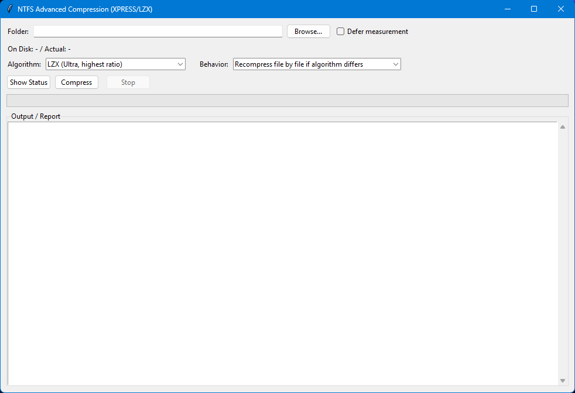

# NTFS Advanced Compression Tool

A modern GUI application for Windows that enables advanced NTFS compression using XPRESS and LZX algorithms. This tool provides an easy-to-use interface for compressing files and folders with Windows' built-in advanced compression algorithms, offering better compression ratios than the traditional NTFS compression.


[](https://buymeacoffee.com/bariselcii)

## Features

- 🗜️ **Multiple Compression Algorithms**
  - XPRESS4K (Fast, low compression)
  - XPRESS8K (Medium, balanced)
  - XPRESS16K (Slow, higher compression)
  - LZX (Ultra, highest compression ratio)

- 📊 **Detailed Status Reports**
  - View compression status of all files
  - See which algorithm is currently applied
  - Display actual size vs. size on disk
  - Calculate compression savings percentage
  - Browse reports in pages of 500 rows and export the entire report as CSV

- 🎯 **Smart Compression Options**
  - Skip already compressed files
  - Recompress files if algorithm differs
  - Balanced defaults: XPRESS8K and skip files that are already compressed
  - Exclude extensions and folders using optional patterns
  - Remove compression with the Decompress action
  - Skip files at most one actual volume cluster and known compressed formats
  - Remember verified no-benefit files until they change
  - Optional per-user Explorer right-click actions for files and folders
  - Verbose logging toggle for detailed output control

- 💻 **User-Friendly Interface**
  - Modern Tkinter GUI
  - Progress, elapsed time, processed bytes per second, and estimated time remaining
  - Live log output with performance optimizations
  - Stop operation at any time

- 📈 **Comprehensive Reporting**
  - Before and after disk space comparison
  - Verified success, failure, skipped, and unprocessed counts
  - Separate scan and final-measurement errors
  - Easy-to-read formatted output

## Requirements

- **Operating System**: Windows 10/11 (with NTFS filesystem)
- **Python**: 3.12 or higher, including Tkinter
- **Privileges**: Write access to the selected folder and files; elevation may be needed for protected folders

## Installation

1. **Download the latest release**
   - Go to [Releases](https://github.com/b-elci/ntfs-compactor/releases)
   - For the v1.6.0 candidate, download `NTFS-Compactor-v1.6.0-Windows-x64.zip`
   - Extract the complete folder and run `NTFS-Compactor-v1.6.0.exe`; keep `_internal` beside it
   - Protected folders may require administrator rights
   - The candidate is unsigned; SmartScreen may show an unknown-publisher warning
   - No Python installation needed!

2. **Or clone the repository** (for Python users)
   ```bash
   git clone https://github.com/b-elci/ntfs-compactor.git
   cd ntfs-compactor
   ```

3. **No external dependencies required!**
   The application uses only Python standard library modules.

4. **Run the application**
   ```bash
   python compactor.py
   ```

   Or run as administrator (recommended):
   - Right-click on `compactor.py`
   - Select "Run as administrator"

## Usage

### Basic Usage

1. **Select a Folder**
   - Click the "Browse..." button
   - Choose the folder you want to compress
   - Measurement runs when an operation starts; selecting a folder does not trigger a scan

2. **Choose Compression Algorithm**
   - **XPRESS4K**: Fastest compression, lowest ratio (~5-15% savings)
   - **XPRESS8K**: Balanced performance and compression (~10-25% savings)
   - **XPRESS16K**: Slower compression, better ratio (~15-35% savings)
   - **LZX**: Best compression ratio, slowest (~20-50% savings)

3. **Select Behavior**
   - **Skip**: Don't recompress files that are already compressed
   - **Recompress if different**: Recompress files that use a different algorithm

4. **Operations**
   - **Show Status**: Scan and display current compression status without making changes
   - **Compress**: Apply selected compression algorithm to all files in folder
   - **Decompress**: Remove compression from matching compressed files, after confirmation
   - **Stop**: Cancel the current operation
   - **Previous / Next**: Browse the status report, 500 rows per page
   - **Save Report**: Export every scanned row, including rows on other pages

### Advanced Options

- **Exclude extensions**: Separate entries with `;`, for example `zip; .mp4; *.jpg`.
  Matching is case-insensitive. Leave blank to include all extensions.
- **Exclude folders**: Use names, relative paths, or wildcard patterns separated
  by `;`, for example `cache; node_modules; backups/*`. Matching folders are
  pruned before their contents are scanned. Directory symlinks and junctions
  are not followed; file symlinks are skipped.
- **Smart filtering** is enabled by default for compression. It uses the selected
  volume's actual cluster size, skips files no larger than one cluster and common
  compressed formats (JPEG/PNG, MP4/MP3/OGG, ZIP/7z, etc.). These format rules are
  heuristics; disable the option when you deliberately want to try these files.
  It does not filter status scans or decompression.
- Verified Windows no-benefit outcomes are cached per algorithm under
  `%LOCALAPPDATA%\NTFSCompactor\no-gain.sqlite`. Size, write time, and NTFS change
  time invalidate cached outcomes after edits, including edits preserving write
  timestamps. The cache does not estimate compressibility by reading entire files.
- **Tools > Choose file** targets a single file; its siblings are not processed.
- **Tools > Install Explorer menu** installs per-user Show status, Compress, and
  Decompress actions for files, directories, and directory backgrounds. Removal
  is available in the same menu. No administrator rights are needed to install
  these HKCU entries. On Windows 11, use **Show more options**. Reinstall after
  moving the program folder. The ZIP also includes install/remove `.cmd` helpers.
- Filters apply to status, compression, decompression, and size measurements.
  Before/after totals describe matching files rather than excluded content.
- Folder, filter, and algorithm controls are locked for the duration of an
  operation. Clear Report is disabled during a scan; an export during a scan
  contains the rows received so far. Copy Page copies only the displayed page.
- Compression batches start at 32 files and adapt up to 128 after successes;
  failures are retried in smaller groups, excluding already verified successes.
- Stop also works while `compact.exe` is silent. Windows calls already in flight
  may finish before cancellation is observed. Cancelled runs skip the final
  full size measurement. An interrupted run may have changed some files;
  run Show Status to inspect their final state.
- Extended paths unsupported by `compact.exe` use a separate cancellable helper
  process calling the documented Windows WOF/NTFS APIs. Windows no-benefit results
  are counted as skipped, rather than repeatedly treated as compression errors.
- Throughput represents logical bytes processed, including failed attempts that
  reached a final outcome. ETA is approximate and depends on file sizes and
  compressibility. It is not a benchmark of the compression algorithm.

### Understanding the Output

The status report shows:
```
Status       | Algorithm    | Size → On Disk      | Savings % | File Path
-------------|--------------|---------------------|-----------|----------
Compressed   | LZX          | 10.50 MB → 5.25 MB  | 50%       | C:\path\to\file.dat
Uncompressed | -            | 2.00 MB → 2.00 MB   | 0%        | C:\path\to\file2.txt
```

## How It Works

This tool wraps the Windows `compact.exe` command-line utility with a modern GUI:

1. **Status Checking**: Queries exact XPRESS/LZX status using Windows' `WofIsExternalFile` API
2. **Compression**: Applies compression using `compact /c /exe:algorithm`
3. **Recompression**: Changes differing algorithms directly using `compact /F`
4. **Size Measurement**: Uses Windows API `GetCompressedFileSizeW` for accurate disk space reporting
5. **Decompression**: Uses `compact /u /i /f` and verifies the resulting state
6. **Scalability**: A single initial scan writes a temporary operation plan;
   reports are stored in a temporary SQLite database, keeping only the visible
   page in the UI. No external Python packages are required.
7. **Validation**: Checks the volume is NTFS and tests folder write access before
   starting. Each operated file's final compression state is checked via the
   Windows API; localized command output is used for diagnostics, not success
   detection. After an operation, the old status report is cleared to avoid
   displaying stale results.

### Compression Algorithms

- **XPRESS**: Microsoft's fast compression algorithm with multiple block sizes
- **LZX**: Microsoft's high-ratio compression based on LZ77 and Huffman coding
- **LZNT1**: Legacy NTFS compression (detected but not applied by this tool)

## Screenshots



*The modern GUI interface showing compression options, progress tracking, and live output.*

## Important Notes

⚠️ **Warnings and Limitations**

1. **Windows Only**: This tool only works on Windows with NTFS file system
2. **Permissions**: Folder write access is checked up front; individual file ACLs or locks can still cause failures
3. **File Access**: Files in use cannot be compressed
4. **Performance**: Compression is CPU-intensive and may take time for large folders
5. **Compatibility**: Compressed files remain fully compatible and accessible
6. **Decompression**: Files automatically decompress when copied to non-NTFS drives

## Best Practices

- 🎯 **Start Small**: Test on a small folder first to understand the behavior
- 💾 **Choose Wisely**: Use LZX for archival data, XPRESS8K for frequently accessed files
- ⏱️ **Be Patient**: Large folders can take considerable time to compress
- 🔄 **Backup First**: Although safe, always backup important data before compression
- 📊 **Monitor Results**: Use "Show Status" to verify compression results

## Troubleshooting

**Problem**: "Access Denied" errors
- **Solution**: Run as Administrator

**Problem**: Files not compressing
- **Solution**: Ensure files are not in use and the file system is NTFS

**Problem**: Slow performance
- **Solution**: Use faster algorithm (XPRESS4K) or enable "Defer measurement"

**Problem**: Compression not showing results
- **Solution**: Check that the drive supports NTFS compression

## Contributing

For Windows release builds, code signing, and antivirus false-positive reports,
see [BUILDING.md](BUILDING.md).

Run the existing tests with `python -m unittest discover -v`. On Linux, native
Windows DLL loading is stubbed for logic tests; real Windows compression is
not validated. GUI workflow tests use real Tk widgets with mocked Windows
operations and require Windows or a Linux X display (`DISPLAY`).

Contributions are welcome! Please feel free to submit a Pull Request. For major changes:

1. Fork the repository
2. Create your feature branch (`git checkout -b feature/AmazingFeature`)
3. Commit your changes (`git commit -m 'Add some AmazingFeature'`)
4. Push to the branch (`git push origin feature/AmazingFeature`)
5. Open a Pull Request

## License

This project is licensed under the MIT License - see the [LICENSE](LICENSE) file for details.

## Acknowledgments

- Built with Python's Tkinter for cross-version compatibility
- Uses Windows API for accurate size reporting
- Leverages Windows built-in `compact.exe` utility
- Icon: [Data compression icons created by Freepik - Flaticon](https://www.flaticon.com/free-icons/data-compression)

## Author

**Barış Elçi** ([b-elci](https://github.com/b-elci))

Created with ❤️ for the Windows power user community

## Support

If you encounter any issues or have questions:
- Open an issue on GitHub
- Check existing issues for solutions

## Support the Project

If you find this tool useful, consider supporting its development:

☕ **[Buy Me a Coffee](https://buymeacoffee.com/bariselcii)**

Your support helps maintain and improve this project!

---

**Note**: This tool provides a user-friendly interface to Windows' built-in compression features. It does not introduce any new compression algorithms or modify Windows system files.
